# 2026 — Fundamentos de la Ciencia de Datos
# Trabajo Práctico Especial

**Grupo 26v**  
- Benito, Nicolás  
- Raffaeli, Esteban  
- Holzmann, Aitor  

---

# 1. Introducción

## 1.1. ¿Cómo se obtuvieron los datos del dataset?
Los datos de este dataset no se obtuvieron mediante una encuesta o un muestreo aleatorio. Es una recopilacion de datos publica, proveniente de Open Food Facts. Es una asociasion sin fines de lucro con sede en francia que no recibe financiamiento de la industria alimentaria.
La informacion es cargada por voluntarios que escanean los codigos de barras de los productos y suben fotos de la lista de ingredientes de cada uno.
La organizacion no garantiza que los datos sean exactos o completos.
Teniendo en cuenta estas consideraciones, comenzamos con el analisis.

> **Referencia en la notebook:** sección *Descargamos el dataset*.

## 1.2. Análisis preliminar
Lo primero que hacemos es mirar las primeras 5 filas del dataset y la informacion de las variables para ver cuantas tenemos, cantidad de registros, algunos valores cargados, formatos, tipo de datos, cantidad de no nulos, etc.

El siguiente paso es analizar los datos estadisticos de nuestras variables cuantitativas con un `describe()`.
Esto nos aporta informacion sobre la media, mediana, rangos, valores maximos, valores minimos y desvio std entre otras.

Una vez analizado todo esto vamos al siguiente paso que es la clasificacion de variables.
Hicimos una clasificacion entre variables cualitativas nominales y ordinales, variables cuantitativas continuas y discretas y variables dicotomicas.
Tambien, para tener una mejor interpretacion de los datos, renombramos las variables.

> **Referencia en la notebook:** sección *Analisis parte 1*, subsecciones *Leemos el archivo y analizamos los primeros detalles*, *Clasificamos las variables* y *Renombramos columnas*.

## 1.3. Limpieza de datos
Lo primero que hicimos para esta etapa fue borrar las variables que no eran de utilidad para el estudio de nuestras hipotesis.
Comenzamos realizando una copia del dataset para mantener los datos originales separados por si precisabamos recuperar algun dato.

La primera variable que eliminamos fue la de "tipo alimento" la cual al explorarla tenia un unico valor para todos los registros lo cual no aportaba ninguna informacion de utilidad.

> **Referencia en la notebook:** sección *Limpieza de variables parte 2*, subsección *Eliminamos columnas*.

### Categorías
Luego limpiamos la columna "categorias".
Para esto tuvimos que tomar una decision ya que muchos productos pertenecian a mas de una categoria. De mantenerlas todas hubieras trabajado con varias entradas que dejaban de ser independientes y repetian mucha informacion.
Por lo tanto optamos por quedarnos solamente con la categoria principal de cada producto. 
Tambien borramos las etiquetas de idioma ya que no aportaban informacion reelevante para el estudio.
Otra decicion que tomamos fue unificar categorias que representaban lo mismo pero estaban escritas de manera diferente, por ejemplo "beverages" y "beverages-and-beverages-preparations".
Las categorias con menos de 100 productos pasaron al grupo de "otros".
Los productos sin categorias quedaron con categoria "nulo".
Creamos una columna nueva llamada "categoria_principal" y borramos la columna original "categorias".
Una vez terminada la limpieza hicimos un grafico de torta para ver la distribucion de las categorias principales.

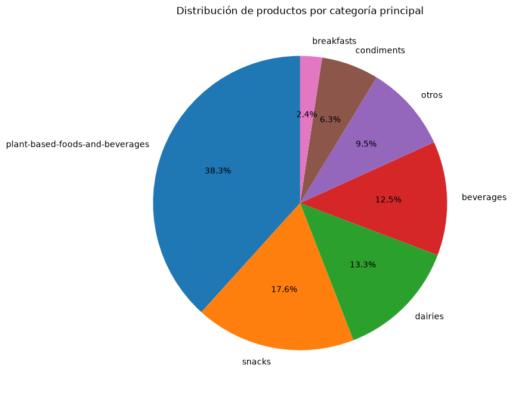
*Fig. 1: Distribución porcentual de productos según su categoría principal luego de agrupar categorías menores en "otros".*

> **Referencia en la notebook:** sección *Limpieza de variables parte 2*, subsección *Limpiamos la columna categorias.*

### Alérgenos
Igual que para la variable categorias lo primero que hicimos fue borrar las etiquetas de los idiomas, ya que no aportan informacion reelvante para nuestro analisis.
Luego analizamos la variable "alergenos declarados" y contamos para ver cuantas ocurrencias tenia cada uno.
Para poder hacer un estudio sobre este tema, buscamos informacion en internet sobre cuales son los principales alergenos obligatorios declarados por la union europea y los enmarcamos como "alergenos oficiales".
Luego hicimos un conteo de cuantos alergenos declarados no entraban en las categorias oficiales y las descartamos.
Creamos un diccionario para unificar los datos repetidos pero que representaban lo mismo, por ejemplo "milk" y "milk-protein" son lo mismo.
En este proceso se descartaron un total de 205 etiquetas, las cuales representan un 3,5% de los datos.
Una vez realizado todo esto, miramos cuantos alergenos declarados quedaron junto con sus ocurrencias.
Siendo el gluten el principal con un total de 1705 ocurrencias y luego la leche con un total de 1513 ocurrencias, lo cual lo podemos atribuir a que la mayoría de los alimentos son producidos con harinas de trigo y leche como base (panificados, galletitas, chocolates, snacks, etc). En cambio alérgenos como moluscos casi ni aparecen ya que son ingredientes muy poco comunes.
Una vez analizado todo esto, creamos una columna nueva llamada "cantidad de alergenos" la cual muestra por producto cuantos alergenos declara. Por ejemplo hay 1741 productos que no declaran ningun alergeno, hay 156 productos que declaran 4 alergenos, etc..
Acompañamos este analisis con un grafico de barras horizontales para ver el porcentaje que de productos que declaran alergenos, por ejemplo el 32% de los productos del dataset declaran alergenos en gluten.

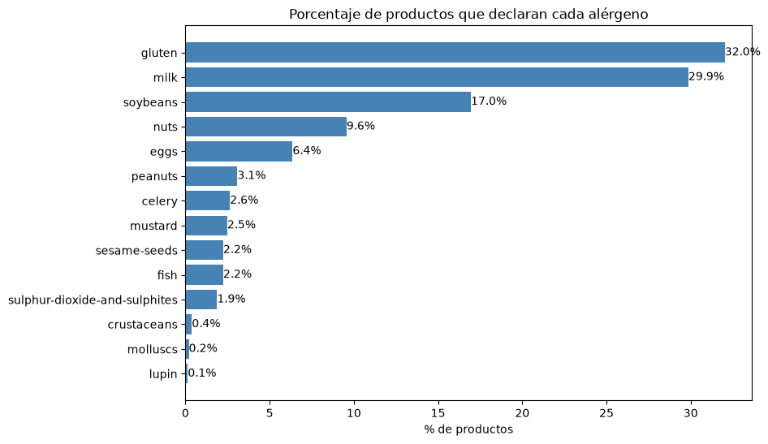
*Fig. 2: Porcentaje de productos del dataset que declaran cada uno de los 14 alérgenos oficiales del Reglamento (UE) 1169/2011.*

> **Referencia en la notebook:** sección *Limpieza de variables parte 2*, subsección *Limpiamos la columna de alergenos.*

### Filas duplicadas
Buscamos que cantidad de filas duplicadas habia en el dataframe. Con filas duplicadas nos referimos a filas que tienen exactamente los mismo valores en todas sus variables.
Encontramos un total de 74 filas duplicadas en nuestro data set de estudio, pero como ya habiamos hecho algunas modificaciones tambien lo chequeamos con el data set original, el cual arrojo un total de 38 filas duplicadas.
Analizamos los datos repetidos y la diferencia en algunos estaba solamente en el idioma.
El siguiente paso fue eliminar esas filas duplicadas.

> **Referencia en la notebook:** sección *Limpieza de variables parte 2*, subsección *Buscamos filas duplicadas*.

### Modificamos tipos de datos
Las columnas "contiene_x" por ejemplo "contiene gluten" tenia valores booleanos los cuales transformamos en numericas binarias (dicotomicas), teniendo un "1" si contiene y "0" si no contiene.

La variable "grado de procesamiento" o "NOVA" estaba en tipo flotante, la convertimos a entera ya que no tiene valores decimales. Esta variable representa una variable cualitativa ordinal que indica que grado de procesamiento tiene cada alimento.
Si no tenian valores cargados los dejamos como Nan.

La variable "grado nutricional" tomaba valores que iban desde la "A" a la "E". Convertimos a entero con valores de "1 a 5". Aquellos valores NOT-APLICABLE o UNKNOWN los dejamos como nulos.
Estos valores los agregamos en una nueva columna que se llama "Grado nutricional numerico" que es la que luego utilizaremos para evaluar la hipotesis.

El mismo trabajo hicimos para la variable "Impacto ambiental" pasando de valores "A-PLUS a F" a valores numericos enteros (de 1 a 7). Valores NOT-APLICABLE o UNKNOWN quedaron como nulos.

> **Referencia en la notebook:** sección *Limpieza de variables parte 2*, subsección *Modificamos tipos de datos*.

### Eliminamos valores imposibles
Algunos alimentos tenian cargados valores que son fisicamente imposibles. Por ejemplo un producto que tiene mas de 100 gramos de grasa saturada cada 100 gramos de producto es imposible. Esto corresponde sin dudas a datos mal cargados.
En total reemplazamos por nulo (None) esos 9 valores mal cargados sin borrar el producto entero, para no perder el resto de sus datos.

> **Referencia en la notebook:** sección *Limpieza de variables parte 2*, subsección *Modificamos tipos de datos › Eliminamos valores imposibles de las columnas de kcalorias, gasa saturada, carbohidratos, proteinas y grasa*.

### Organización del trabajo
El resto del informe se organiza de la siguiente manera: en la **Sección 2** desarrollamos el análisis exploratorio de los datos (EDA) con sus gráficos y distribuciones; en la **Sección 3** planteamos y resolvemos las 6 hipótesis de trabajo (las 2 univariadas, las 2 bivariadas y las 2 multivariadas); y en la **Sección 4** presentamos las conclusiones generales del estudio.

Todo el código del trabajo se encuentra en la notebook `main.ipynb`. En cada apartado del informe indicamos explícitamente en qué sección de la notebook está implementado lo que se describe, para que se pueda consultar el código correspondiente. La correspondencia completa es la siguiente:

| Sección del informe | Sección de la notebook (`main.ipynb`) |
|---|---|
| 1.1. ¿Cómo se obtuvieron los datos del dataset? | *Descargamos el dataset* |
| 1.2. Análisis preliminar | *Analisis parte 1* › *Leemos el archivo y analizamos los primeros detalles*, *Clasificamos las variables*, *Renombramos columnas* |
| 1.3. Limpieza de datos | *Limpieza de variables parte 2* › *Eliminamos columnas*, *Limpiamos la columna categorias.*, *Limpiamos la columna de alergenos.*, *Buscamos filas duplicadas*, *Modificamos tipos de datos* (incluye *Eliminamos valores imposibles...*) |
| 2. Análisis exploratorio de los datos | *Analisis parte 1* › *Graficamos variables para analizar* |
| 3.1. Hipótesis 1 (univariada propia) | *Hipotesis Univariadas* › *Mas del 50% del total de los alimentos son ultraprocesados (grado_de_procesamiento 4)* |
| 3.2. Hipótesis 2 (univariada de la cátedra) | *Hipotesis Univariadas* › *La proporción de productos catalogados como "altos en grasas saturadas"...* |
| 3.3. Hipótesis 3 (bivariada propia) | *Hipotesis Bivariadas* › *Los alimentos con alto grado de procesamiento tienen mas impacto ambiental* |
| 3.4. Hipótesis 4 (bivariada de la cátedra) | *Hipotesis Bivariadas* › *El grado de procesamiento industrial de un alimento está asociado con la calificación nutricional Nutri-Score...* |
| 3.5. Hipótesis 5 (multivariada propia) | *Hipotesis Multivariadas* › *Energia explicada por macronutrientes (proteinas, grasas, carbohidratos)* |
| 3.6. Hipótesis 6 (multivariada de la cátedra) | *Hipotesis Multivariadas* › *El grado de procesamiento industrial (NOVA), la categoría del producto y la cantidad de alérgenos declarados...* |

---

# 2. Análisis exploratorio de los datos

> **Referencia en la notebook:** sección *Analisis parte 1*, subsección *Graficamos variables para analizar*.

Como un primer paso, graficamos la distribucion de algunas variables para ver como se distribuyen los datos.
Hicimos un histograma para ver como se distribuye "energia_kcal_100g" que representa cuanta energia aportan los alimentos cada 100 gramos, pudiendo observar que hay muchos alimentos que aportan poca energia lo cual tiene sentido ya que en la base del grafico deben estar alimentos como aguas, gaseosas sin azucar, tés y otros productos que prácticamente no aportan calorías.

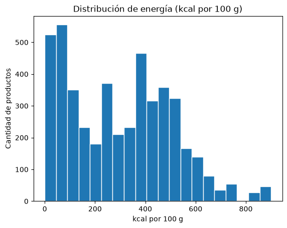
*Fig. 3: Histograma de distribución de energía en kcal por cada 100 g de producto.*

Tambien graficamos con histogramas la distribucion de las "proteinas cada 100 gramos" y de los "azucares cada 100 gramos".

Para el grafico de proteinas cada 100 gramos hicimos un boxplot para ver cuantos valores outliers tenia y donde se encontraba la mediana (50% de los datos) viendo asi que la mitad de los alimentos tienen 6.3 gramos de proteina cada 100 gramos, esto lo podemos atribuir a que la mayoria de los productos de supermercado suelen ser empaquetados como bebidas, dulces, panes, snack, etc los cuales casi que no tienen proteinas. Los alimentos que superan la mediana por mucho deben ser productos ricos en proteinas como carnes, atun, etc. 

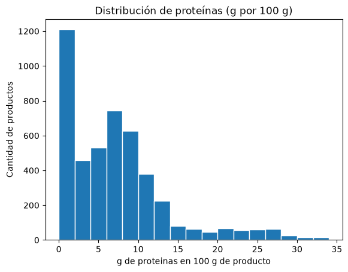
*Fig. 4: Histograma de distribución de proteínas en gramos por cada 100 g de producto.*

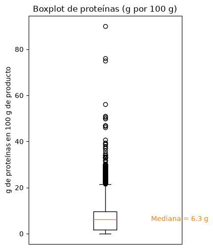
*Fig. 5: Boxplot de proteínas cada 100 g indicando la mediana en 6.3 g y los valores atípicos superiores.*

Para el grafico de azucares hicimos un ajuste de escala y trazamos 2 lineas punteadas que representan la media y la mediana para poder visualizar la distribucion de los datos de mejor manera.

En el gráfico observamos que la mediana (4.3g) y la media (12.4) están muy separadas y esto se debe a que en los supermercados la gran mayoria de productos tal vez son salados aportando muy poca azucar, en cambio los alimentos que son dulces aportan muchisima azucar lo que hace que la media se corra bastante a la derecha.

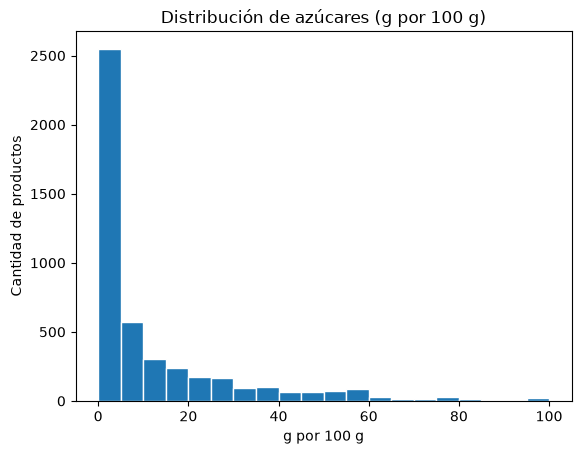
*Fig. 6: Histograma completo de distribución de azúcares en gramos por cada 100 g de producto.*

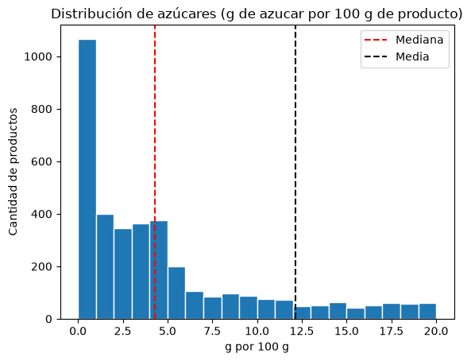
*Fig. 7: Distribución de azúcares escalada (0 a 20 g/100 g) comparando la mediana (4.3 g, línea roja) y la media (12.4 g, línea negra).*

El siguiente grafico que realizamos es un grafico de barras para ver los distintos grados de procesamiento que tenian los alimentos junto con la cantidad de alimentos que habia en cada grupo. Tambien agregamos una columna pinta de gris que representa aquellos alimentos para los cuales su grado de procesamiento no es conocido. Esto se puede dar porque no se cargaron los datos o porque al cargar el alimento no se cargaron los ingredientes y no se pudo calcular el grado de procesamiento.

El hecho de que los alimentos con grado de procesamiento 4 sea el grupo mas grande se debe a como fue armado el dataset. Las personas que cargaron los datos deben ser clientes que consumen más productos ultraprocesados lo cual es bastante común hoy en dia.

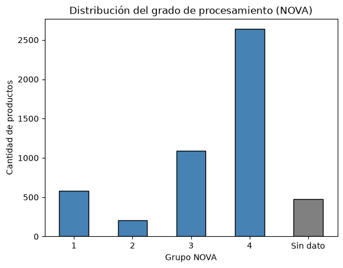
*Fig. 8: Cantidad de productos según su grupo de procesamiento industrial NOVA (1 a 4) y registros sin dato en gris.*

Hicimos el mismo proceso que el anterior para ver la distribucion de los grupos de "impacto ambiental" el cual nos dice que tanto impacto ambiental genera ese alimento siendo "A" muy poco impacto y "F" mucho impacto ambiental.
A continuacion de este grafico tambien analizamos cuantos datos "UNKNOWN" y "NOT APLICABLE" habia. Siendo este grupo bastante numeroso con aproximadamente 1000 datos en este grupo, esto lo atribuimos a que los UNLNOWN son productos a los que les faltan datos de origen para calcular el impacto, en cambio los NON-APPLICABLE deben ser alimentos como aguas u otros alimentos que no entran en el calculo del impacto ambiental.

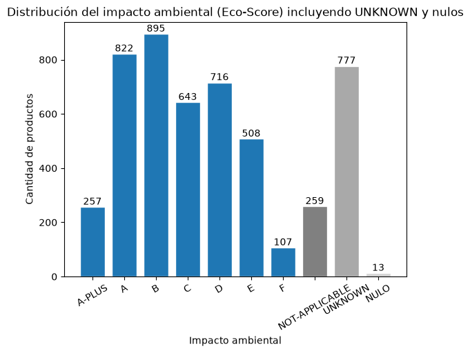
*Fig. 9: Distribución del impacto ambiental (Eco-Score de A-PLUS a F) incluyendo las categorías NOT-APPLICABLE, UNKNOWN y nulos.*

Para todas las variables que representan la composicion de los alimentos como por ejemplo "grasas saturadas cada 100 gramos" hicimos varios boxplot para mirar de manera grafica su distribucion junto con sus valores OUTLIERS.

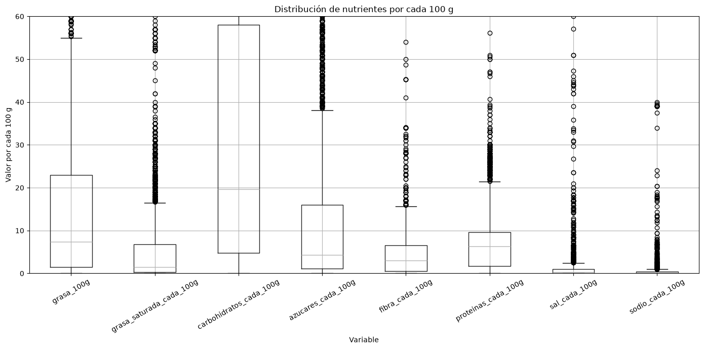
*Fig. 10: Boxplots comparativos de las variables nutricionales expresadas cada 100 g de producto.*

Tomamos la variable "grasas saturadas" y realizamos un grafico de barras en el cual marcamos dos grupos.
Alto en grasas saturadas (mas de 5g cada 100g) y bajo en grasas saturadas (menos de 5g cada 100g).
En el grafico de barras trazamos la linea del primer cuartil (25% de los datos totales) para tener una referencia grafica de los porcentajes.

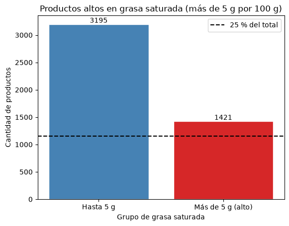
*Fig. 11: Cantidad de productos con hasta 5 g vs. más de 5 g de grasa saturada cada 100 g, junto al umbral del 25% del total.*

Para terminar los primeros analisis graficos, hicimos un grafico de barras agrupando por su "grado de procesamiento" mostrando su "valor nutricional" como un primer vistazo grafico sobre la hipotesis de que un alimento con alto grado de procesamiento tiene bajo valor nutricional.

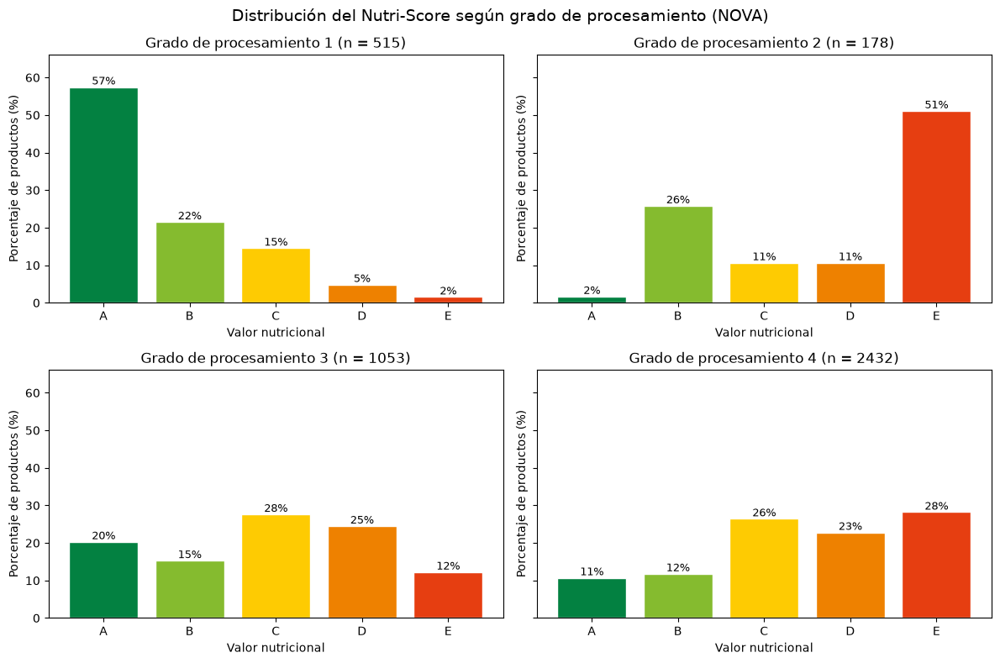
*Fig. 12: Distribución porcentual preliminar de calificaciones Nutri-Score (A a E) dentro de cada grupo NOVA.*

Graficamente vemos un patron que respaldaria nuestra teoria pero se rompe en el segudo grafico de "grado de procesamiento 2". Esta hipotesis la vamos a estudiar mas adelante.

---

# 3. Hipótesis y resolución

## 3.1. Hipótesis 1: Mas del 50% del total de los alimentos son ultraprocesados (grado_de_procesamiento 4)

> **Referencia en la notebook:** sección *Hipotesis Univariadas*, subsección *Mas del 50% del total de los alimentos son ultraprocesados (grado_de_procesamiento 4)*.

### 3.1.1. Definición de la hipótesis
Planteamos esta hipótesis univariada propia para verificar si la mayoría (más del 50%) de los alimentos registrados en la base corresponden a productos ultraprocesados (clasificación NOVA 4), motivados por el predominio de productos empaquetados industriales observado en el análisis exploratorio.

- **Hipótesis nula (H₀):** El 50% de los alimentos o menos son ultraprocesados (p ≤ 0.50).

- **Hipótesis alternativa (H₁):** Más del 50% de los alimentos son ultraprocesados (p > 0.50).

### 3.1.2. Estrategia de abordaje
Para hacer un chequeo rapido lo primero que hicimos fue contar cuantos productos teniamos con grado de procesamiento declarado y cuantos tenemos con grado de procesamiento 4 para hacer una cuenta rapida.
Tambien chequeamos esto de manera grafica con un grafico de barras, marcando la division de la mediana %50 de los datos.
Para terminar de validar nuestra hipotesis realizamos un test chi cuadrado, en el cual planteamos que nuestra hipotesis nula (HO) que el 50% de los alimentos o menos son ultraprocesados y nuestro (H1) que mas del 50% de los alimentos son ultraprocesados.

### 3.1.3. Resultados obtenidos y discusión
Esto nos dio que el 58% de los alimentos que tienen grado de procesamiento declarado (2624 de 4497), son ultraprocesados (grado 4), es decir que esto confirma que casi 6 de cada 10 productos son ultraprocesados y no alimentos naturales con mínimamente procesados.

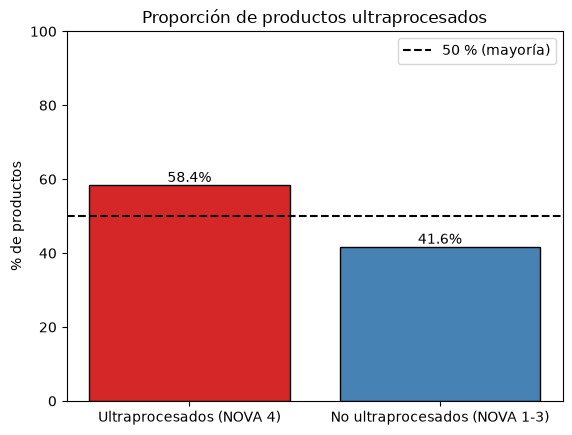
*Fig. 13: Proporción de productos ultraprocesados (NOVA 4: 58.3%) frente a no ultraprocesados (NOVA 1-3: 41.7%), con línea de referencia en el 50%.*

Obtuvimos un p valor muy chico < 0,05 (p = 4.12 × 10⁻²⁹) lo que **rechaza nuestra H0 y confirma la hipótesis planteada: más del 50% de los alimentos del mercado analizado son ultraprocesados**.

---

## 3.2. Hipótesis 2: La proporción de productos catalogados como "altos en grasas saturadas" (más de 5 g de grasa saturada por cada 100 g de producto) en la población de referencia es superior al 25%

> **Referencia en la notebook:** sección *Hipotesis Univariadas*, subsección *La proporción de productos catalogados como "altos en grasas saturadas" (más de 5 g de grasa saturada por cada 100 g de producto) en la población de referencia es superior al 25%.*

### 3.2.1. Definición de la hipótesis
Se busca evaluar la hipótesis univariada propuesta por la cátedra: comprobar si más de un cuarto (25%) de los productos del catálogo superan el umbral crítico de 5 gramos de grasa saturada por cada 100 gramos de alimento.

- **Hipótesis nula (H₀):** La proporción de productos con más de 5 g de grasa saturada es menor o igual al 25% (p ≤ 0.25).

- **Hipótesis alternativa (H₁):** La proporción de productos con más de 5 g de grasa saturada es superior al 25% (p > 0.25).

### 3.2.2. Estrategia de abordaje
Lo primero que hicimos antes de validar esta hipotesis fue hacer un boxplot de la variabel "grasa saturada cada 100 gramos" lo cual nos permite visualizar los cuartiles.
Trazamos una linea marcando donde estan los 5 gramos de grasa saturadas.
Tambien hicimos la cuenta matematica de productos con mas de 5 gramos de grasa saturada / total de productos y realizamos un test chi cuadrado para validar si nuestra hipotesis se cumple.

### 3.2.3. Resultados obtenidos y discusión
Vemos que el tercer cuartil estan los productos con 6,8 gramos de grasa saturadas o mas. Por lo tanto, graficamente vemos que hay mas de 25% con 5 gramos o mas de grasa satruada.

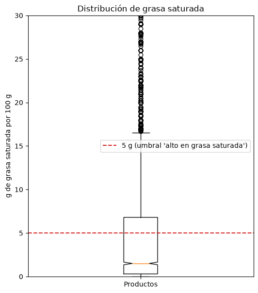
*Fig. 14: Boxplot de grasa saturada cada 100 g mostrando el umbral de 5 g (línea roja) por debajo del tercer cuartil Q3 = 6.8 g.*

La cuenta matematica de productos con mas de 5 gramos de grasa saturada sobre el total de productos (1413 de 4595) nos da una proporcion del 30,8%. Otro indicio de que la hipotesis debiera ser verdadera.
En el test chi cuadrado, como obtuvimos un p valor muy bajo (p = 2.20 × 10⁻¹⁹ < 0.05), **rechazamos H0 lo cual valida y confirma nuestra hipótesis: más del 25% de los productos son altos en grasas saturadas**.

---

## 3.3. Hipótesis 3: Los alimentos con alto grado de procesamiento tienen mas impacto ambiental

> **Referencia en la notebook:** sección *Hipotesis Bivariadas*, subsección *Los alimentos con alto grado de procesamiento tienen mas impacto ambiental*.

### 3.3.1. Definición de la hipótesis
Planteamos esta hipótesis bivariada propia para analizar si a medida que aumenta el grado de procesamiento industrial de un alimento (NOVA 1 a 4), empeora también su impacto ambiental medido por el Eco-Score.

- **Hipótesis nula (H₀):** El impacto ambiental se distribuye igual en los 4 grupos NOVA.

- **Hipótesis alternativa (H₁):** El impacto ambiental difiere entre los grupos NOVA (aumentando con el procesamiento).

### 3.3.2. Estrategia de abordaje
Para hacer este analisis, lo primero que hicimos fue separar en un dataframe auxiliar las variables que eran de interes para nuestro estudio que son "grado de procesamiento" e "impacto ambiental".
Hicimos un grafico de barras, el cual nos muestra agrupado por grado de procesamiento (de 1 a 4) la cantidad de productos con su impacto ambiental.
El primer paso para chequear nuestra hipotesis con un test es validar si las variables siguen una distribucion normal o no mediante el test de normalidad Shapiro-Wilk y de manera grafica con un QQplot.
Luego chequeamos la homocedasticidad de las variables para ver si sus varianzas son iguales con un test de Levene.
Como no se cumplen los supuestos de normalidad ni homocedasticidad, optamos por un test no parametrico "Kruskal-Wallis" y finalmente comparamos la mediana y la media de cada grupo.

### 3.3.3. Resultados obtenidos y discusión
Al mirar la grafica por grupos vemos una pequeña tendencia pero que no es tan lineal como creeriamos. Uno asume que los ultraprocesados serian los de mayor impacto ambiental pero descubrimos que los de grado 2 tienen el mayor impacto lo cual luego de investigar lo atribuimos a que este grupo de alimentos están hechos de una materia prima que contamina mucho mas como por ejemplo la manteca (gases de efecto invernadero en ganaderia), aceites vegetales (kilos de cultivos para un litro), etc.

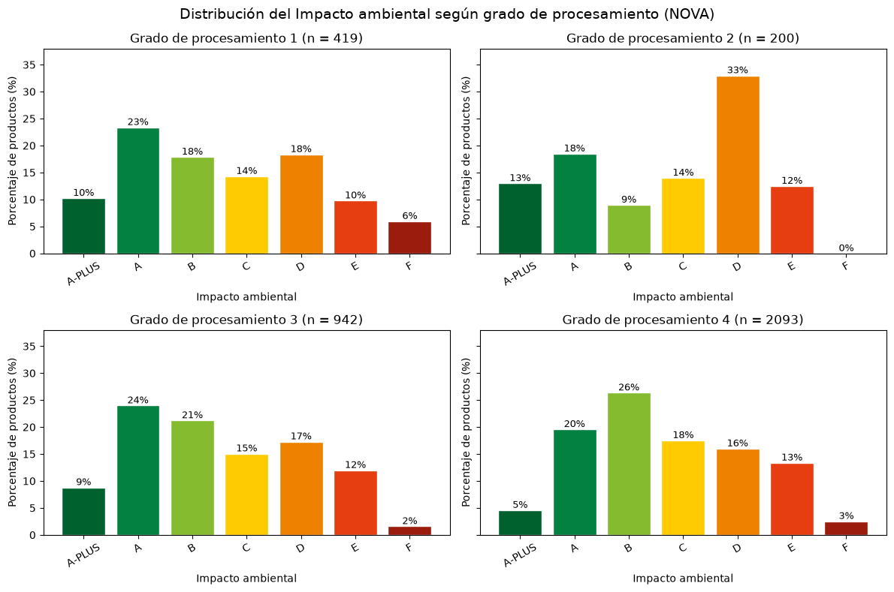
*Fig. 15: Distribución porcentual del impacto ambiental (Eco-Score de A-PLUS a F) dentro de cada grupo NOVA.*

Realizamos el test de normalidad shapito wilks, el cual da como resultado que no son normales (p < 0.05 en los 4 grupos). Esperabamos este resultado ya que nuestras variables son categoricas ordinales y son discretas. Tambien lo vemos de manera grafica con el QQplot:

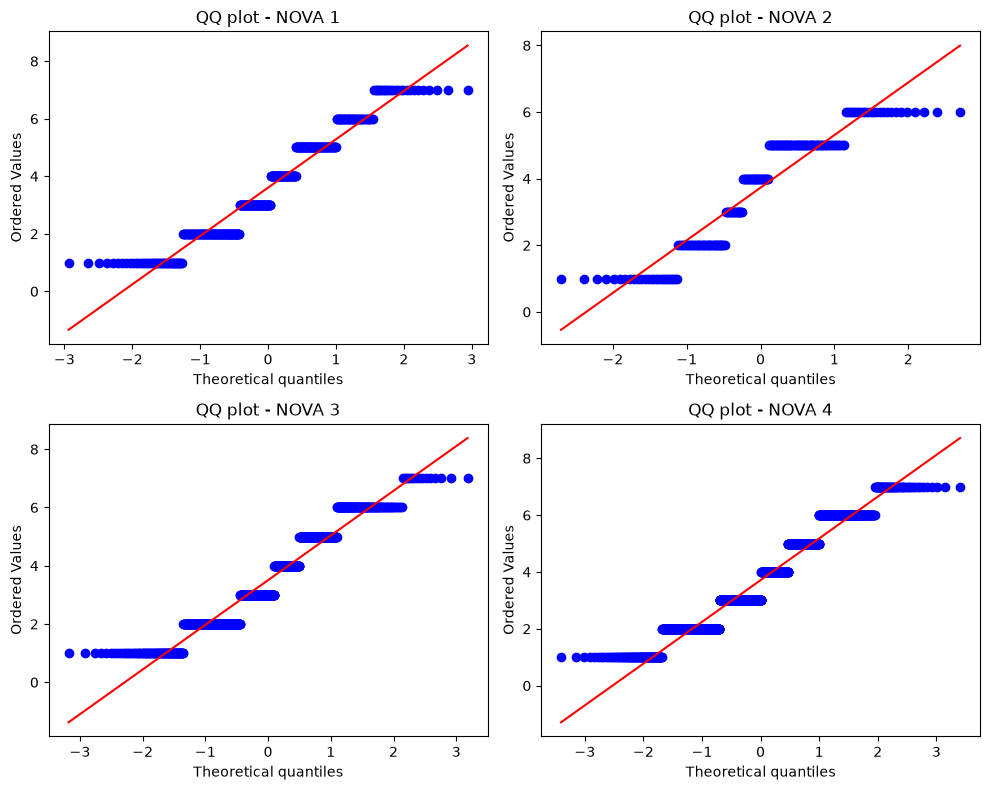
*Fig. 16: Gráficos QQ-plot de impacto ambiental numérico para cada grupo NOVA, evidenciando la falta de normalidad.*

En el test de levene para ver si sus varianzas son iguales, como era de esperarse, esto tampoco se cumple (p-valor = 0.0023 < 0.05).
El resultado del test no parametrico "kruskall wallis" (p = 0.00395 < 0.05), al rechazar H0, nos demuestra que los grupos no son iguales entre si.
El siguiente paso fue analizar la media de cada grupo (NOVA 1: media 3.60, mediana 3.0; NOVA 2: media 3.73, mediana 4.0; NOVA 3: media 3.50, mediana 3.0; NOVA 4: media 3.71, mediana 3.0) y lo que pudimos observar fue que el grupo de "grado de procesamiento 2" es el que mas impacto ambiental tiene, mientras que el grado de "procesamiento 3" es el que menos impacto ambiental tiene, por lo tanto **la hipótesis NO se confirma: concluimos que no hay evidencia significativa para afirmar que un producto con mayor grado de procesamiento genera un mayor impacto ambiental**.

---

## 3.4. Hipótesis 4: El grado de procesamiento industrial de un alimento está asociado con la calificación nutricional Nutri-Score que recibe, de manera que los productos más procesados presentan calificaciones más desfavorables

> **Referencia en la notebook:** sección *Hipotesis Bivariadas*, subsección *El grado de procesamiento industrial de un alimento está asociado con la calificación nutricional Nutri-Score que recibe, de manera que los productos más procesados presentan calificaciones más desfavorables.*

### 3.4.1. Definición de la hipótesis
Evaluamos la hipótesis bivariada propuesta por la cátedra: determinar si el grado de procesamiento NOVA se asocia con el Nutri-Score haciendo que los productos más procesados reciban peores calificaciones nutricionales.

- **Hipótesis nula (H₀):** El grado nutricional se distribuye igual en todos los grupos NOVA.

- **Hipótesis alternativa (H₁):** Al menos un grupo difiere y las calificaciones empeoran a mayor procesamiento.

### 3.4.2. Estrategia de abordaje
Lo primero que hacemos es traer el grafico que hicimos en la etapa 1 pero sobre el dataset limpio. Para hacer el analisis grafico armamos 4 grupos donde cada grupo representa un "grado de procesamiento" distintos y miramos la cantidad de ocurrencias en cada "valor nutricional".
Chequeamos normalidad con Shapiro-Wilk y QQ-plots, y homocedasticidad con el test de Levene.
Como no se cumplen los supuestos planteamos un test no parametrico "Kruskal-Wallis" y comparamos las medianas y el porcentaje de calificaciones D/E en cada grupo.

### 3.4.3. Resultados obtenidos y discusión
Como habiamos visto previamente, pareciera que a menor grado de procesamiento, mayor valor nutricional. Pero el grupo de "grado de procesamiento 2" pareciera romper este patron.

*Fig. 17: Distribución porcentual del Nutri-Score (A a E) según grado de procesamiento NOVA sobre los datos limpios.*

Al chequear normalidad con shapiro wilks y QQplot, el p valor nos da muy chico como esperabamos (p < 0.05 en los 4 grupos), no son normales. Pasa lo mismo que el caso anterior, son variables categoricas ordinales.

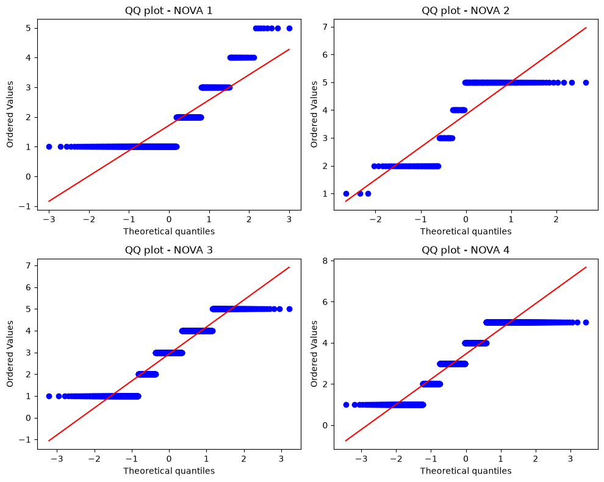
*Fig. 18: Gráficos QQ-plot de Nutri-Score numérico por cada grupo NOVA.*

Lo mismo pasa con la homosedastisidad: realizamos un test de levene y como suponiamos, las varianzas son distintas (p = 1.32 × 10⁻¹⁷ < 0.05).
El test no parametrico "kruskall wallis" nos dio un p valor muy chico (p = 1.28 × 10⁻¹⁵⁰ < 0.05), rechazando H0 que dice que todos los grupos se comportan igual.
Al ver el comportamiento de cada grupo (NOVA 1: mediana 1.0 [A], 6.4% en D/E; NOVA 2: mediana 5.0 [E], 61.9% en D/E; NOVA 3: mediana 3.0 [C], 36.5% en D/E; NOVA 4: mediana 4.0 [D], 51.0% en D/E), como vimos graficamente, entre los grupos 1, 3 y 4 se cumple claramente el patrón y el que rompe el patron es el grupo 2.
Investigando los productos que componen el grupo 2 en el dataset, concluimos que esto se da a que el grupo 2 contiene alimentos que son "aceite, sal, vinagre, azucares, manteca.. etc". Todos productos que tienen bajo grado de procesamiento pero que aportan muy poco valor nutricional cada 100 g, ya que suelen ir acompañados de otros alimentos a la hora de consumirse. Por lo tanto, **la hipótesis se confirma para los alimentos elaborados (NOVA 1, 3 y 4), con la excepción explicada de los ingredientes culinarios (NOVA 2)**.

---

## 3.5. Hipótesis 5: Energia explicada por macronutrientes (proteinas, grasas, carbohidratos)

> **Referencia en la notebook:** sección *Hipotesis Multivariadas*, subsección *Energia explicada por macronutrientes (proteinas, grasas, carbohidratos)*.

### 3.5.1. Definición de la hipótesis
Planteamos esta hipótesis multivariada propia para comprobar si la energía en kilocalorías cada 100 gramos (`energia_kcal`) se explica linealmente a partir del contenido de grasas totales, carbohidratos y proteínas. Antes de realizar este test, buscamos informacion en internet sobre este tema y encontramos que hay una formula que estima la energia en kilo calorias que aportan los alimentos en funcion de otros nutrientes. Por ejemplo, 1 gramo de grasa aporta 9 kilocalorias, 1 gramo de proteinas aporta 4 kilocalorias y 1 gramo de carbohidratos aporta 4 kilocalorias.

### 3.5.2. Estrategia de abordaje
Para esto hicimos un modelo de regresion lineal multiple por minimos cuadrados ordinarios (OLS) sobre los 4619 productos sin nulos en esas cuatro variables.
Luego analizamos los supuestos del modelo lineal mediante el grafico de residuos vs. valores ajustados, el estadistico de Durbin-Watson, el QQ-plot de los residuos y una tabla de auditoria de los residuos extremos fuera de ±3 desvios.

### 3.5.3. Resultados obtenidos y discusión
El modelo resulto globalmente significativo (Prob F-statistic < 0.05), explicando el **97,4%** de la variabilidad de la energia (R² = R² ajustado = 0.974).

Los resultados obtenidos para los coeficientes fueron:

- **Grasa:** 8.92 kcal

- **Carbohidratos:** 3.99 kcal

- **Proteínas:** 4.42 kcal

Son muy cercanos a los planteados por la formula que habiamos encontrado.
Analizamos los supuestos:

- **Linealidad y homocedasticidad:** el gráfico de residuos vs. valores ajustados muestra una banda pareja alrededor de cero en todo el rango.

- **Independencia:** el estadístico de Durbin-Watson (1.98) es cercano a 2, por lo que no hay evidencia de autocorrelación.

- **Normalidad:** no se cumple (Prob Omnibus < 0.05, kurtosis = 210). Sin embargo, el incumplimiento no se debe a un mal ajuste general: la gran mayoría de los residuos está concentrada muy cerca de cero, y la falta de normalidad la producen unas pocas observaciones con residuos extremos. La asimetría negativa indica que estos casos tienen una energía declarada mucho menor a la esperada según su composición; por ejemplo, productos con 100 g de grasa y 0 kcal. Se interpretan como errores de carga en el dataset o productos con componentes no contemplados por el modelo.
Para ver la normalidad de los residuos hicimos un QQplot de los residuos en el cual apreciamos que la mayor dispercion esta en las colas.

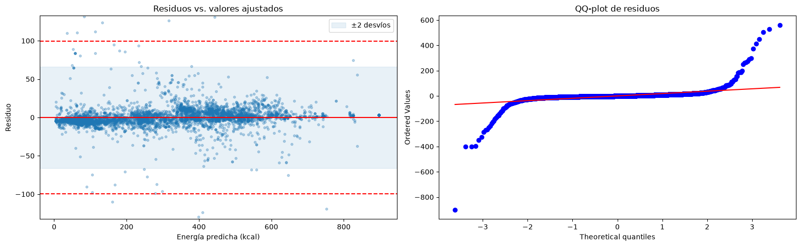
*Fig. 19: Diagnóstico del modelo lineal: gráfico de bandas de residuos vs. valores ajustados (izquierda) y QQ-plot de residuos (derecha).*

Luego hicimos una tabla para ver que tan lejos estaban los residuos y la conclusion que obtuvimos fue que eran valores mal cargados, ya que habia muchos productos (7 casos) con proteinas, grasas y carbohidratos declarados pero que tenian 0 energia.

**En conclusión: Los resultados validan y confirman la hipótesis planteada: "la energía de los alimentos se explica casi en su totalidad por su contenido de grasa, carbohidratos y proteínas"**. 
Además, el modelo recupera a partir de los datos los factores energéticos teóricos, y muestra que la grasa es el macronutriente que más aporta por gramo, aproximadamente el doble que carbohidratos y proteínas.
Como la energia ya esta declarada en la etiqueta, este modelo nos permite validar si la energia en kcal declarada por los alimentos es correcta o no.

---

## 3.6. Hipótesis 6: El grado de procesamiento industrial (NOVA), la categoría del producto y la cantidad de alérgenos declarados explican conjuntamente la probabilidad de que un producto reciba una calificación Nutri-Score desfavorable (D/E), sin utilizar directamente su composición nutricional

> **Referencia en la notebook:** sección *Hipotesis Multivariadas*, subsección *El grado de procesamiento industrial (NOVA), la categoría del producto y la cantidad de alérgenos declarados explican conjuntamente la probabilidad de que un producto reciba una calificación Nutri-Score desfavorable (D/E), sin utilizar directamente su composición nutricional.*

### 3.6.1. Definición de la hipótesis
Se evalúa la hipótesis multivariada planteada por la cátedra: comprobar si es posible explicar y clasificar la probabilidad de que un alimento tenga un Nutri-Score desfavorable (categorías D o E) a partir de su grupo NOVA, su categoría principal y la cantidad de alérgenos declarados, sin usar las variables de nutrientes cada 100 g.

### 3.6.2. Estrategia de abordaje
Lo primero que hicimos antes de validar esta hipotesis fue fijarnos cuantos productos catalogaban como desfavorable (D/E) y favorable (A/B/C) segun su valor nutricional. Viendo asi que un 42% de los productos son catalogados como desfavorables.

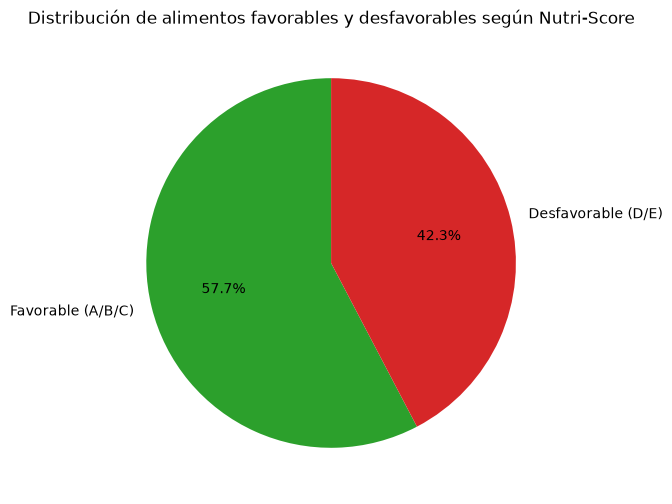
*Fig. 20: Gráfico de torta con la proporción de alimentos favorables (A/B/C: 57.7%) y desfavorables (D/E: 42.3%).*

Pasamos todas las variables cualitativas que tenemos a variables dummies para poder hacer un modelo de regresion logistica, que utilizaremos para clasificar los productos en los grupos "Desfavorables" o "Favorables".

Separamos los datos de entrenamiento (80%) de los datos de testeo (20%), buscando que en ambos grupos quede una proporcion similar de casos desfavorables (42%).

Antes de entrenar el modelo, estandarizamos las variables para mantenerlas en la misma escala. Para esto solo usamos los datos de entrenamiento ya que si incluiamos tambien los datos de testeo, el modelo iba a aprender tambien sobre ellos y no nos iban a servir para comprobar como funcionaba nuestro modelo.

El entrenamiento del modelo lo hicimos con el algoritmo K-Fold, utilizando validacion cruzada para 5 grupos distintos.

### 3.6.3. Resultados obtenidos y discusión
Con este entrenamiento obtuvimos una exactitud promedio del 73,9% (74%).
El siguiente paso fue buscar mejorar el modelo utilizando regularizadores, el cual si bien mejoro el modelo, no fue una mejora tan significativa logrando llegar al 74,5% (con C = 0.1).
Esto indica que el modelo original no presentaba sobreajuste, algo esperable dado el bajo número de variables.

Una vez entrenado el modelo pasamos a testearlo usando el conjunto de datos de test.
Como resultado obtuvimos la matriz de confusion la cual arrojo los mismos resultados tanto con regularizador como sin (exactitud en test del **74,6%** frente al **57,6%** de predecir siempre la clase mayoritaria), confirmando lo visto previamente.

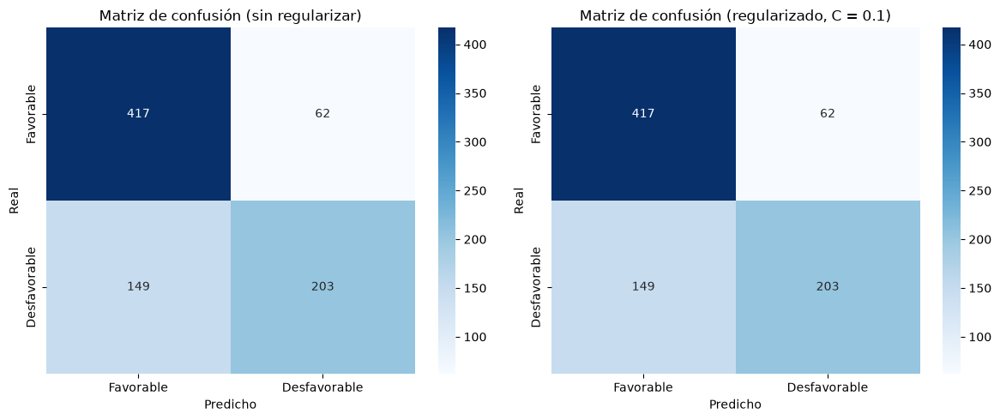
*Fig. 21: Matrices de confusión sobre el conjunto de test para la regresión logística sin regularizar (izquierda) y regularizada con C = 0.1 (derecha).*

El modelo clasifica con mayor precisión a los productos favorables que a los desfavorables: de los 352 productos D/E del conjunto de test, 149 fueron clasificados erróneamente como favorables.

Para finalizar realizamos un grafico de pesos aprendidos por el regresor logistico para ver cuanto aporta cada coeficiente al modelo.

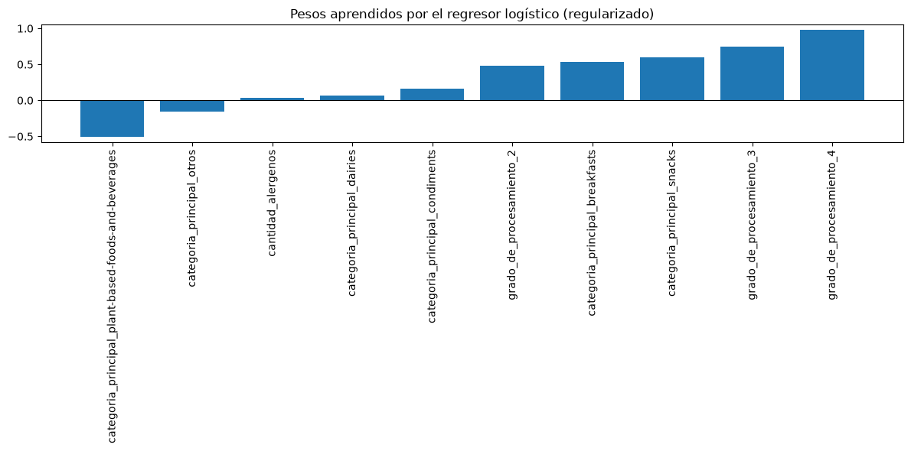
*Fig. 22: Coeficientes (pesos) aprendidos por la regresión logística regularizada para cada variable predictora estandarizada.*

**En conclusión: La hipótesis se valida parcialmente**. Si bien el grado de procesamiento, la categoría y la cantidad de alérgenos aportan información significativa sobre la calidad nutricional de un producto (mejorando la exactitud del 57.6% base al 74.6%), no logra explicar el "valor nutricional" de manera completa ya que el modelo detecta solo el 57.7% de los productos desfavorables. 
Esto se explica porque el "valor nutricional" se calcula a partir de la composición nutricional, y dentro de una misma categoría y grupo de procesamiento hay productos con perfiles nutricionales muy diferentes. 
Por lo tanto, el procesamiento y la categoría funcionan como indicadores aproximados de la calidad nutricional, pero no reemplazan la información de la composición del producto.

---

# 4. Conclusiones

A partir del trabajo de limpieza, exploración y validación de hipótesis realizado sobre el dataset de Open Food Facts, llegamos a las siguientes conclusiones principales:

1. **Importancia de la limpieza en bases colaborativas:** Como los datos son cargados manualmente por voluntarios escaneando paquetes, fue indispensable unificar idiomas y sinónimos (tanto en categorías como en los 14 alérgenos oficiales de la UE), eliminar los 74 productos duplicados y pasar a nulos los 9 valores físicamente imposibles (>100 g cada 100 g o >900 kcal) antes de correr cualquier test.
2. **Predominio de ultraprocesados y grasas saturadas en góndola:** Con los tests univariados confirmamos que en esta base de productos empaquetados **más de la mitad (58.4%) son ultraprocesados (NOVA 4)** y **más de un cuarto (30.8%) son altos en grasas saturadas (>5 g)**, lo que refleja el perfil real de los productos industriales con código de barras.
3. **Diferencia entre calidad nutricional e impacto ambiental según NOVA:** Con los análisis bivariados vimos que subir en el grado de procesamiento NOVA **sí empeora claramente el valor nutricional (Nutri-Score)** entre los alimentos listos para consumir (NOVA 1, 3 y 4), pero **no aumenta de forma lineal el impacto ambiental (Eco-Score)**. En ambos casos el grupo NOVA 2 (aceites, manteca, sal y azúcar) rompió el patrón por tratarse de ingredientes culinarios concentrados cuya materia prima (como la ganadería en la manteca o los cultivos aceiteros) tiene alto impacto ambiental y alta densidad calórica por cada 100 gramos.
4. **Alcance de los modelos multivariados:** Con la regresión lineal múltiple comprobamos que los gramos de grasa, carbohidratos y proteínas **explican el 97.4% de las calorías**, recuperando los factores teóricos (9, 4 y 4 kcal/g) y sirviendo como herramienta para detectar errores de carga en las etiquetas (como los 7 productos que declaraban 0 kcal teniendo macronutrientes). Por último, con la regresión logística demostramos que conocer el grupo NOVA y la categoría del producto **permite predecir correctamente el 74.6% de las calificaciones favorables/desfavorables sin mirar la tabla nutricional**, aunque funciona como una aproximación y no reemplaza por completo a los gramos de nutrientes.

---

# Referencias

1. **Open Food Facts** — Base de datos abierta y colaborativa de productos alimenticios: https://world.openfoodfacts.org/
2. **Reglamento (UE) Nº 1169/2011 del Parlamento Europeo y del Consejo** — Anexo II: Sustancias o productos que causan alergias o intolerancias (14 alérgenos de declaración obligatoria).
3. **Sistema de clasificación NOVA (Monteiro et al.)** — Clasificación de los alimentos según su grado de procesamiento industrial (grupos 1 a 4).
4. **Santé Publique France / ADEME** — Metodología de cálculo de etiquetado nutricional **Nutri-Score** (escala A a E) e indicador ambiental **Eco-Score** (escala A-PLUS a F).
